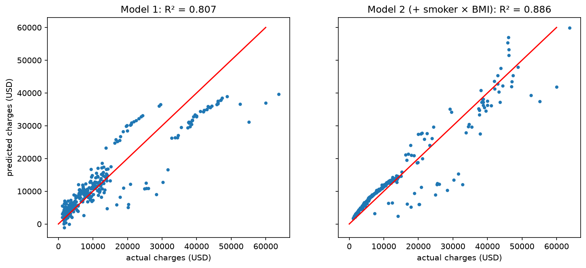
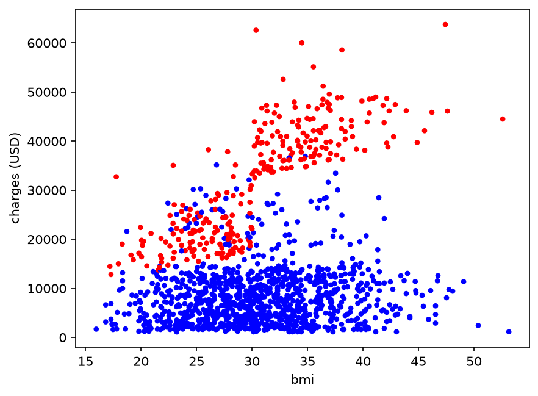
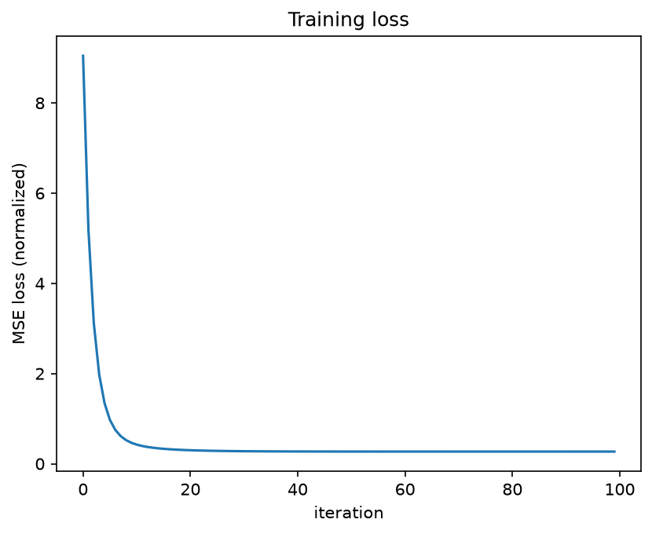

# Insurance Charges Prediction with Linear Regression (PyTorch)

Predicting medical insurance charges from age, BMI, smoking status and other features, using linear regression implemented from scratch in PyTorch (matrix form, manual gradient descent, no `nn.Module` or `autograd`).

## Results

| Model | Features | Test R² | Test MAE |
|---|---|---|---|
| Linear regression | 8 | 0.807 | 4,177 USD |
| + smoker × BMI interaction | 9 | 0.886 | 2,828 USD |

The from-scratch model reaches the same solution as scikit-learn's `LinearRegression` (same R² and weights to 3 decimals).



## Key finding

Smoking is the strongest predictor of charges. The EDA also showed that BMI barely matters for non-smokers, while smokers split into two groups around BMI 30:



A plain linear model gives BMI one fixed weight for everyone, so it cannot capture this. Adding a single feature, `smoker × BMI`, cut the average error by about 32% without changing the model.

## Method

1. EDA: data quality checks (1 duplicate row removed), distributions, feature relationships
2. Preprocessing: one-hot encoding (`drop_first=True`), 80/20 train/test split, standardization fitted on train only
3. Model: `y_hat = X @ w + theta0`
4. Loss: mean squared error
5. Optimizer: batch gradient descent with hand-derived gradients
6. Evaluation on the test set: R², MAE, predicted vs actual plot



## Limitations and next steps

- Some non-smokers have high charges that no feature explains. The dataset does not contain the information needed to predict them.
- Smokers' charges jump at BMI 30 (the WHO obesity threshold) rather than rising smoothly, so a `smoker × (BMI ≥ 30)` feature may fit better.
- Features were compared on the test set. A separate validation set would be the cleaner approach.

## How to run

```bash
git clone https://github.com/jvd1990/insurance-linear-regression-pytorch.git
cd insurance-linear-regression-pytorch
python -m venv .venv
.venv\Scripts\activate        # Windows
pip install -r requirements.txt
jupyter notebook insurance_linear_regression.ipynb
```

## Data

[Medical Cost Personal Dataset](https://www.kaggle.com/datasets/mirichoi0218/insurance) (Kaggle): 1,338 samples, 6 features.

## Acknowledgements

The approach follows week 2 (linear regression) of the Howsam PyTorch course, extended here from one feature to multiple features with matrix-form gradients.